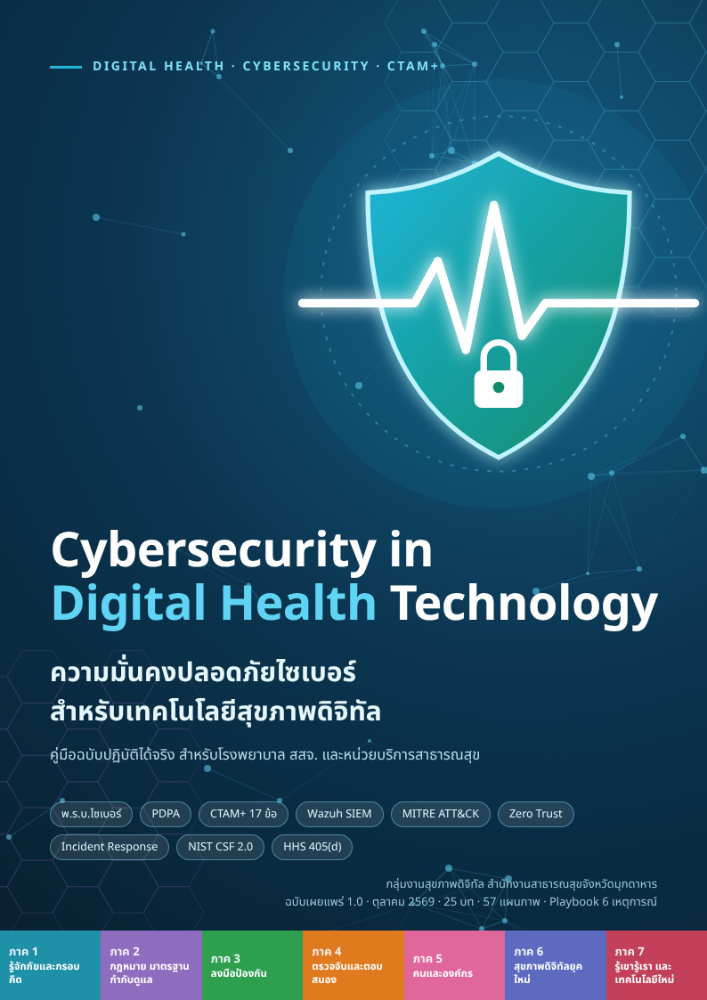

# ความมั่นคงปลอดภัยไซเบอร์สำหรับเทคโนโลยีสุขภาพดิจิทัล
### Cybersecurity in Digital Health Technology

คู่มือฉบับปฏิบัติการสำหรับโรงพยาบาลและหน่วยบริการสาธารณสุขไทย 25 บท 260 หน้า มีภาพประกอบ แผนภาพ และ Flow 57 ภาพ อธิบายตั้งแต่เหตุผลที่ระบบสุขภาพตกเป็นเป้าหมาย กฎหมายและเกณฑ์ CTAM+ ของกระทรวงสาธารณสุข ไปจนถึงขั้นตอนลงมือป้องกัน ตรวจจับ รับมือเหตุ และเทคโนโลยีใหม่ แต่ละบทมีวัตถุประสงค์ ขั้นตอนทำตาม หลักฐานที่ใช้ตอบเกณฑ์ สรุปท้ายบท และคำถามทบทวนพร้อมแนวคำตอบ

ฉบับเผยแพร่ 1.0 (ตุลาคม 2569) ข้อมูลในเล่มเป็นข้อมูล ณ 31 ตุลาคม 2569

 

## ดาวน์โหลด

| ไฟล์ | เหมาะกับ |
|:--|:--|
| [หนังสือฉบับเต็ม PDF](Cybersecurity-in-Digital-Health-Technology.pdf) | อ่านบนคอมพิวเตอร์และพิมพ์ มีสารบัญ Bookmark ทุกบทและหัวข้อ ดัชนีคำค้น 103 คำ |
| [หนังสือฉบับ EPUB](Cybersecurity-in-Digital-Health-Technology.epub) | อ่านบนมือถือหรือแท็บเล็ต (Apple Books, Google Play Books) ตัวอักษรปรับขนาดได้ |
| [ฉบับเว็บไซต์ (index.html)](index.html) | ไฟล์เดียวเปิดในเบราว์เซอร์ได้ทันทีโดยไม่ต้องต่ออินเทอร์เน็ต หรือเผยแพร่ผ่าน GitHub Pages |
| [ฉบับผู้บริหาร 10 หน้า](Cybersecurity-in-Digital-Health-Technology-Executive-Edition.pdf) | ผู้อำนวยการ CIO และคณะกรรมการ สรุปความเสี่ยง สิ่งที่ต้องตัดสินใจ และแผน 12 เดือน |

## ชุดเครื่องมือ (Toolkit)

| ไฟล์ | ใช้ทำอะไร |
|:--|:--|
| [Cyber-Health-Toolkit.xlsx](toolkit/Cyber-Health-Toolkit.xlsx) | สมุดงาน 10 แผ่น: แดชบอร์ดสรุป, ติดตาม CTAM+ 17 ข้อ, ประเมิน Maturity 10 ด้านพร้อมกราฟเรดาร์, ทะเบียนความเสี่ยง, ทะเบียนทรัพย์สิน, ติดตามช่องโหว่ KEV, ทดสอบกู้คืน, บันทึกเหตุการณ์ (นับเวลาแจ้ง Health CERT 24 ชม. และ สคส. 72 ชม.), บันทึกการอบรม |
| [01 นโยบายความมั่นคงปลอดภัยไซเบอร์](toolkit/01-นโยบายความมั่นคงปลอดภัยไซเบอร์.docx) | แม่แบบนโยบายของหน่วยงาน |
| [02 แบบรายงานเหตุการณ์ภัยคุกคามไซเบอร์](toolkit/02-แบบรายงานเหตุการณ์ภัยคุกคามไซเบอร์.docx) | รายงานเหตุเบื้องต้น |
| [03 SITREP รายงานสถานการณ์](toolkit/03-SITREP-รายงานสถานการณ์.docx) | รายงานความคืบหน้าระหว่างเหตุ |
| [04 แบบถอดบทเรียน AAR](toolkit/04-แบบถอดบทเรียน-AAR.docx) | ถอดบทเรียนหลังเหตุหรือหลังซ้อม |
| [05 แม่แบบคำเตือนภัยและแบบรายงานกลับ](toolkit/05-แม่แบบคำเตือนภัยและแบบรายงานกลับ.docx) | ส่งคำเตือนพร้อมป้าย TLP และรับผลกลับจากหน่วยบริการ |
| [06 แบบทดสอบก่อนและหลังอบรม](toolkit/06-แบบทดสอบก่อนและหลังอบรม.docx) | 20 ข้อ พร้อมเฉลยและบทที่ควรอ่านเพิ่ม |
| [โปสเตอร์กฎทอง 10 ข้อ](toolkit/Poster-10-Golden-Rules.pdf) ([PNG](toolkit/Poster-10-Golden-Rules.png)) | ติดข้างเครื่องคอมพิวเตอร์ เติมเบอร์งาน IT ก่อนพิมพ์ |
| [โปสเตอร์สงสัยว่าถูกโจมตีทำอย่างไร](toolkit/Poster-Incident-First-Steps.pdf) ([PNG](toolkit/Poster-Incident-First-Steps.png)) | ขั้นตอนแรกเมื่อพบเหตุผิดปกติ |

เซลล์สีเหลืองในไฟล์ Excel คือช่องที่ต้องกรอก แถวสีเทาคือตัวอย่างและไม่ถูกนับรวม ชื่อหน่วยงาน ตำแหน่ง และเบอร์ภายในในแม่แบบ Word และโปสเตอร์ เว้นไว้ให้แต่ละหน่วยงานเติมเอง

## เนื้อหา 7 ภาค 25 บท

| ภาค | บท |
|:--|:--|
| 1 รู้จักภัยและกรอบคิด | 1 ทำไมระบบสุขภาพจึงตกเป็นเป้าหมาย · 2 แนวคิดพื้นฐานที่ต้องรู้ |
| 2 กฎหมาย มาตรฐาน และการกำกับดูแล | 3 พ.ร.บ.ไซเบอร์ 2562 และ CII ด้านสาธารณสุข · 4 PDPA สำหรับสถานพยาบาล · 5 นโยบายและมาตรฐานของกระทรวง · 6 CTAM+ ฉบับลงมือทำ |
| 3 ลงมือป้องกัน | 7 บัญชีทรัพย์สินและความเสี่ยง · 8 การยืนยันตัวตนและสิทธิ์ · 9 เครือข่ายและไฟร์วอลล์ · 10 เครื่องลูกข่ายและเซิร์ฟเวอร์ · 11 เว็บแอปพลิเคชันและ WAF · 12 ระบบ HIS และฐานข้อมูล · 13 สำรองข้อมูล 3-2-1 และ BCP/DRP |
| 4 ตรวจจับและตอบสนอง | 14 Log และ SIEM ด้วย Wazuh · 15 Threat Intelligence ด้วย NCSA Blacklist · 16 VA และ Pentest · 17 การรับมือและแจ้งเหตุ |
| 5 คนและองค์กร | 18 Security Awareness · 19 ธรรมาภิบาลและแผนยกระดับระดับจังหวัด/เขต |
| 6 สุขภาพดิจิทัลยุคใหม่และแนวทางสากล | 20 มาตรฐานสากลและบทเรียนต่างประเทศ · 21 อีเมล โดเมน และ Cloud Workspace · 22 อุปกรณ์การแพทย์ PACS, HL7 และระบบอาคาร (OT) |
| 7 รู้เขารู้เรา | 23 ยุทธวิธีผู้โจมตีและการป้องกัน · 24 ระบบประสานข้อมูลและแบ่งปันความรู้ · 25 เทคโนโลยีใหม่ที่ช่วยป้องกัน |

ภาคผนวกมี Checklist หลักฐาน CTAM+ 17 ข้อ แม่แบบเอกสาร คำสั่งที่ใช้บ่อย ช่องทางติดต่อ อภิธานศัพท์ 103 คำพร้อมตัวย่อหน่วยงานภาษาไทย แบบประเมินระดับวุฒิภาวะด้วยตนเอง 10 ด้าน และ **Playbook การ์ดหน้าเดียวพร้อม Flow 6 เหตุการณ์** (Ransomware, ข้อมูลผู้ป่วยรั่วไหล, เว็บไซต์ถูกเปลี่ยนหน้า, คลิกลิงก์ฟิชชิง, อุปกรณ์ที่มีข้อมูลหาย, โทรศัพท์อ้างเป็น IT หรือ Vendor) พิมพ์ติดห้อง IT ไว้ใช้ตอนเกิดเหตุได้ทันที และแนวคำตอบคำถามทบทวนท้ายบท 96 ข้อสำหรับวิทยากร

## ช่องทางแจ้งเหตุทางการ

Health CERT ศทส.สป.สธ.: [health-cirt.moph.go.th](https://health-cirt.moph.go.th) · health-cirt@moph.go.th · LINE @health-cirt

## ข้อควรทราบ

- IP Address และโดเมนในตัวอย่างใช้ช่วงสำหรับเอกสาร (RFC 5737 และ RFC 2606) ไม่ใช่ระบบจริง
- เนื้อหาเรื่องเทคนิคของผู้โจมตีอยู่ในระดับแนวคิดเพื่อการป้องกันและตรวจจับเท่านั้น
- ทดสอบคำสั่งและกฎตรวจจับบนเครื่องทดสอบก่อนใช้กับระบบจริงทุกครั้ง

## สัญญาอนุญาต

เผยแพร่ภายใต้ [Creative Commons Attribution-NonCommercial-ShareAlike 4.0 (CC BY-NC-SA 4.0)](https://creativecommons.org/licenses/by-nc-sa/4.0/deed.th) นำไปใช้สอนและเผยแพร่ต่อได้โดยระบุแหล่งที่มา ห้ามใช้เชิงพาณิชย์ และงานดัดแปลงต้องใช้สัญญาอนุญาตเดียวกัน
